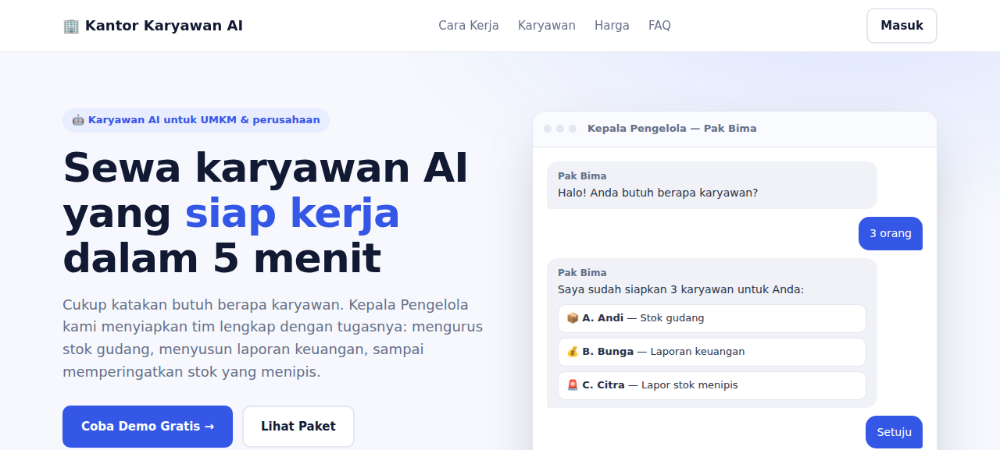
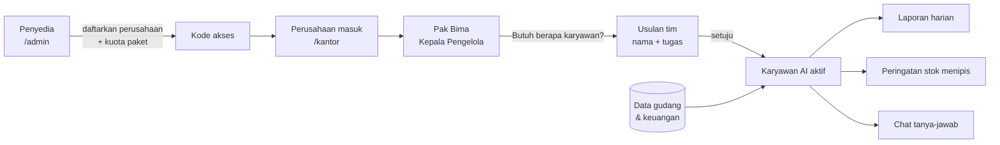
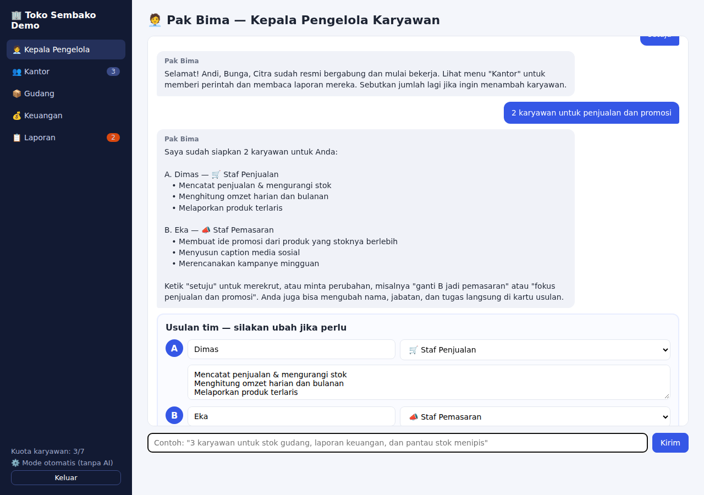
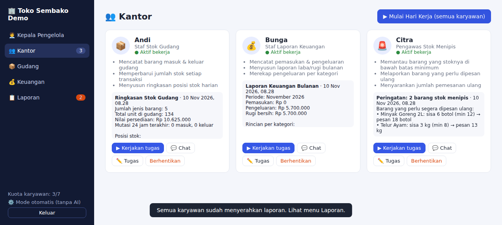
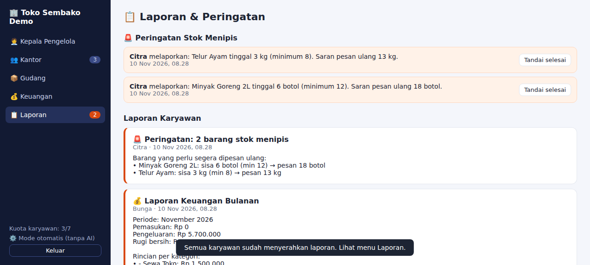
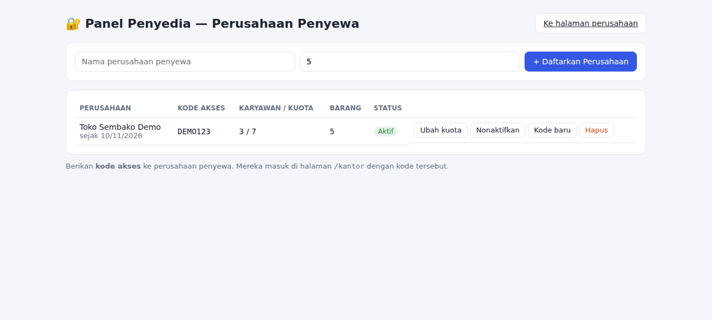

# 🏢 Kantor Karyawan AI

[](https://github.com/kitonekun/Karyawan-ai/actions/workflows/ci.yml)


[](LICENSE)

**Sewakan karyawan AI ke perusahaan.** Setiap penyewa mendapat kantor virtual sendiri. Di sana Kepala Pengelola menanyakan butuh berapa karyawan, menyiapkan nama dan pembagian tugasnya, lalu tim AI langsung bekerja dengan data gudang dan keuangan perusahaan.



## Daftar isi

- [Cara kerja](#cara-kerja)
- [Karyawan yang tersedia](#karyawan-yang-tersedia)
- [Tampilan](#tampilan)
- [Mulai cepat](#mulai-cepat)
- [Konfigurasi](#konfigurasi)
- [Deploy ke VPS](#deploy-ke-vps)
- [Keamanan](#keamanan)
- [Pengembangan](#pengembangan)

## Cara kerja



1. **Penyedia** (Anda) mendaftarkan perusahaan di `/admin`, mengatur kuota karyawan sesuai paket, lalu memberikan kode akses.
2. **Perusahaan** masuk ke `/kantor`. Pak Bima bertanya, misalnya *"Anda butuh berapa karyawan?"* lalu dijawab *"3"*.
3. Pak Bima mengusulkan **A. Andi** (stok gudang), **B. Bunga** (laporan keuangan), dan **C. Citra** (pelapor stok menipis). Usulan bisa diubah lewat chat atau langsung di kartu usulan.
4. Setelah disetujui, karyawan **bekerja dengan data nyata**:
   - Penjualan memotong stok dan tercatat sebagai pemasukan.
   - Stok yang menyentuh batas minimum langsung dilaporkan.
   - Tombol *Mulai Hari Kerja* membuat semua karyawan menyerahkan laporan.

## Karyawan yang tersedia

| Jabatan | Yang dikerjakan |
| --- | --- |
| 📦 Staf Stok Gudang | Mencatat barang masuk/keluar, ringkasan posisi & nilai stok |
| 💰 Staf Laporan Keuangan | Laporan laba/rugi bulanan, rincian per kategori |
| 🚨 Pengawas Stok Menipis | Peringatan otomatis saat stok ≤ minimum + saran jumlah pesan ulang |
| 🛒 Staf Penjualan | Penjualan memotong stok & masuk ke pemasukan, produk terlaris |
| 💬 Customer Service | Template balasan ketersediaan produk |
| 📣 Staf Pemasaran | Ide promosi & caption untuk produk yang stoknya berlebih |
| 🗂️ Admin & Penjadwalan | Rekap aktivitas tim & agenda harian |

Setiap karyawan bisa diminta laporan, diajak chat, diubah tugasnya, atau diberhentikan.

## Tampilan

| Kepala Pengelola menyusun tim | Kantor & laporan karyawan |
| --- | --- |
|  |  |

| Laporan & peringatan stok | Panel penyedia |
| --- | --- |
|  |  |

## Mulai cepat

Hanya butuh **Node.js 18+**. Tidak ada `npm install` karena aplikasi ini tidak memakai dependensi.

```bash
git clone https://github.com/kitonekun/Karyawan-ai.git
cd Karyawan-ai
ADMIN_PASSWORD='ganti-sandi-kuat' npm start
```

| Halaman | Alamat | Untuk |
| --- | --- | --- |
| Landing page | `http://localhost:3000/` | Calon pelanggan |
| Kantor perusahaan | `http://localhost:3000/kantor` | Penyewa (kode demo: **DEMO123**) |
| Panel penyedia | `http://localhost:3000/admin` | Anda, pemilik layanan |
| Health check | `http://localhost:3000/api/health` | Pemantauan uptime |

## Konfigurasi

| Variabel | Bawaan | Keterangan |
| --- | --- | --- |
| `ADMIN_PASSWORD` | `admin123` | **Wajib diganti** di produksi |
| `AI_API_KEY` | – | Opsional. Jika diisi, chat dijawab AI berdasarkan data perusahaan |
| `AI_BASE_URL` | `https://api.openai.com/v1` | Endpoint kompatibel OpenAI (bisa Ollama: `http://localhost:11434/v1`) |
| `AI_MODEL` | `gpt-4o-mini` | Nama model AI |
| `CONTACT_WHATSAPP` | – | Nomor WA (mis. `6281234567890`). Tombol paket di landing page membuka chat WhatsApp |
| `PORT` | `3000` | Port server |
| `DB_FILE` | `data/db.json` | Lokasi file data |
| `BACKUP_DIR` | `data/backups` | Lokasi backup harian |
| `BACKUP_KEEP` | `14` | Jumlah hari backup yang disimpan |

Tanpa `AI_API_KEY`, semua fitur tetap berjalan memakai logika bawaan.
Harga paket di landing page (`public/landing.html`, bagian `#harga`) masih contoh, jadi sesuaikan dengan harga Anda.

## Deploy ke VPS

```bash
# Ubuntu: Node.js 20 + pm2
curl -fsSL https://deb.nodesource.com/setup_20.x | sudo bash -
sudo apt-get install -y nodejs git
sudo npm i -g pm2

git clone https://github.com/kitonekun/Karyawan-ai.git && cd Karyawan-ai
ADMIN_PASSWORD='ganti-sandi-kuat' pm2 start src/server.js --name kantor-ai
pm2 save && pm2 startup
```

Pasang Nginx sebagai reverse proxy ke port 3000 dan aktifkan HTTPS dengan `certbot`.
Arahkan pemantauan uptime ke `/api/health`, lalu salin folder `data/backups/` ke lokasi lain secara berkala.

## Keamanan

- Data setiap perusahaan terpisah, dengan akses lewat kode perusahaan.
- Login dikunci 15 menit setelah 10 kali gagal. Membuat kode baru atau menonaktifkan perusahaan langsung mencabut aksesnya.
- `Content-Security-Policy` tanpa script inline, `X-Frame-Options: DENY`, dan `nosniff` di setiap respons.
- Backup data harian otomatis.

Detail dan cara melaporkan celah ada di [SECURITY.md](SECURITY.md).

## Pengembangan

```bash
npm run check   # cek sintaks semua file JavaScript
npm test        # tes otomatis (logika, API, keamanan)
```

CI menjalankan pengecekan, tes, dan smoke test server di Node 18, 20, dan 22 untuk setiap pull request.
Lihat [CONTRIBUTING.md](CONTRIBUTING.md) untuk alur kerja dan struktur kode.

## Lisensi

Proprietary, semua hak dilindungi. Lihat [LICENSE](LICENSE).
